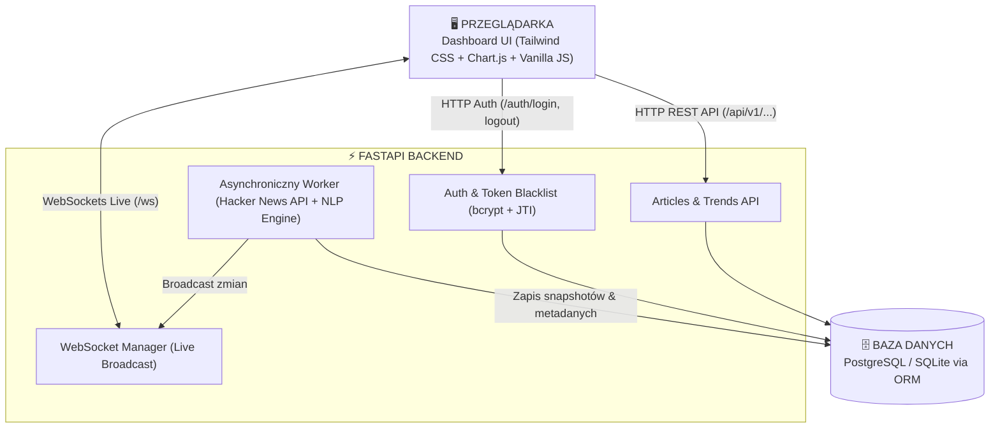

# 🚀 TechTrend Monitor & Live Sentiment Dashboard

W pełni działająca, odporna na awarie i skonteneryzowana aplikacja do monitorowania i analizy sentymentu oraz trendów technologicznych z nowoczesnym dashboardem w czasie rzeczywistym.

---

## 🌟 Główne Funkcjonalności

- **Backend w FastAPI (Python 3.10+)**: Szybki, asynchroniczny backend z obsługą WebSockets, dependency injection, elastycznym routingiem (`/api` oraz `/api/v1`) i OpenAPI/Swagger.
- **Relacyjna Baza Danych i Migracje (SQLAlchemy 2.0 + Alembic)**:
  - Automatyczna obsługa PostgreSQL (w kontenerze Docker) oraz SQLite (lokalnie).
  - Wersjonowane migracje schematu bazy danych (`alembic`).
- **Bezpieczny System Uwierzytelniania & Token Blacklist**:
  - Rejestracja i logowanie użytkowników.
  - Bezpieczne hashowanie haseł algorytmem **bcrypt**.
  - Tokeny JWT z unikalnym identyfikatorem **JTI** (`uuid4`).
  - **Mechanizm unieważniania tokenów (Token Blacklist)**: wylogowanie trwale dodaje token i JTI do bazy unieważnionych tokenów (`revoked_tokens`), a dependency autoryzacji natychmiast odrzuca próby ponownego użycia starego tokena (HTTP 401).
  - Domyślne konto demo: `admin` / `admin123`.
- **Asynchroniczny Worker w Tle & Odporność Sieciowa**:
  - Regularnie (co X minut) pobiera najświeższe artykuły i dyskusje technologiczne z publicznego **Hacker News Firebase API**.
  - Autorski silnik NLP: leksykalna kalkulacja sentymentu (-1.0 do +1.0), dynamiczny wskaźnik aktywnego sentymentu (z odcięciem szumu 0.00), wykrywanie negacji i wzmacniaczy, kategoryzacja technologii (AI, LLM, Python, Rust, Cloud, DevOps, Security, Web itp.) oraz ekstrakcja słów kluczowych.
  - Zapisuje snapshoty trendów w relacji czasowej (`trend_snapshots`) oraz precyzyjne znaczniki synchronizacji (`sync_metadata`).
- **Transmisja Live przez WebSockets**:
  - Dwukierunkowa komunikacja w czasie rzeczywistym (`/ws`).
  - Natychmiastowe rozgłaszanie nowych wpisów i aktualizacji statystyk do podłączonych klientów.
  - Wskaźnik stanu połączenia (LIVE z pulsującą diodą vs automatyczny reconnect).
- **Nowoczesny Dashboard (Tailwind CSS + Chart.js)**:
  - Estetyka dark-mode w stylu *shadcn/ui* z ikonami Lucide.
  - Trzy interaktywne wykresy: popularność technologii (słupkowy), rozkład sentymentu (pierścieniowy), trajektoria sentymentu w czasie (liniowy z dynamicznym auto-zoomem i customowym dymkiem HTML).
  - Tabela z dwuliniowym formatowaniem czasu, filtrowaniem wg technologii i sentymentu, wyszukiwarką live i paginacją.
  - Przycisk ręcznego wymuszenia synchronizacji z animacją rotacji, obsługą błędów i inteligentnym debounce toastów (brak duplikatów z HTTP i WebSocketa).

---

## 🏛️ Architektura Systemu



---

## 🗄️ Baza Danych i Odporność na Współbieżność

### 1. Tabele Relacyjne
- **`users`**: Użytkownicy systemu, unikalne nazwy i maile, hashe bcrypt, status aktywności.
- **`articles`**: Pobrane wpisy, unikalny `external_id`, wyliczony wynik i etykieta sentymentu, zserializowane tagi i słowa kluczowe.
- **`trend_snapshots`**: Klastry czasowe popularności poszczególnych technologii i ich średniego sentymentu.
- **`revoked_tokens`**: Czarna lista unieważnionych tokenów (pole `token`, unikalny `jti`, znacznik `revoked_at` oraz `expires_at`).
- **`sync_metadata`**: Metadane synchronizacji przechowujące dokładny timestamp ostatniej akcji (niezależnie od tego, czy pojawiły się nowe artykuły).

### 2. Odporność SQLite na Współbieżność (Concurrency Shield)
Aby wyeliminować błędy zakleszczeń (`sqlite3.OperationalError: database is locked`) przy intensywnym równoległym ruchu:
- **Tryb WAL (`PRAGMA journal_mode=WAL`)**: Odczyty nigdy nie blokują zapisów, a zapisy nie blokują odczytów.
- **Wydłużony Busy Timeout**: Konfiguracja połączeń `timeout=30` oraz dyrektywa `PRAGMA busy_timeout=30000` wymuszają na bibliotece C bezpieczne oczekiwanie na zwolnienie blokady transakcyjnej.
- **Pętlowy Mutex (`asyncio.Lock`)**: W serwisie `TechDataAggregator` zastosowano asynchroniczny mutex `_get_sync_lock()`, powiązany z bieżącą pętlą zdarzeń. Wszystkie równoległe żądania wymuszenia synchronizacji są bezpiecznie serializowane, zapobiegając wyścigom transakcyjnym i duplikacji zapytań do zewnętrznego API.

---

## 🛡️ Odporność Sieciowa (Network Resilience & Chaos Monkey)

Aplikacja jest w pełni zabezpieczona przed przerwami w dostępie do Internetu i awariami zewnętrznego dostawcy:
- **Brak fałszywych sukcesów**: W przypadku braku łączności (np. `httpx.ConnectError`, `httpx.TimeoutException`, awaria Firebase API), scraper nie udaje pobrania 0 artykułów ani nie generuje mylącego komunikatu *„Baza jest aktualna”*.
- **Czytelny status HTTP 503**: Backend rzuca wyjątek `HackerNewsAPIError`, a endpoint synchronizacji zwraca kod **HTTP 503 Service Unavailable** ze spójnym komunikatem błędu.
- **Obsługa w UI**: Dashboard przechwytuje błąd 503 i prezentuje czytelny, czerwony dymek informujący o braku połączenia z API, zapobiegając dezorientacji użytkownika.
- **Ochrona workera w tle**: Tło wychwytuje błąd sieciowy jako ostrzeżenie w logach i kontynuuje działanie w kolejnym interwale, nie powodując przerwania pętli ani restartu kontenera.

---

## ⚡ Szybki Start z Docker Compose

Całe środowisko (PostgreSQL + aplikacja FastAPI + worker w tle + dashboard) uruchamia się za pomocą Docker Compose.

Dzięki schematowi `version: '3.7'` oraz standardowej liście zależności `depends_on: [db]`, konfiguracja jest w 100% kompatybilna zarówno z nowoczesnym pluginem CLI, jak i starszymi środowiskami (np. WSL2 / Docker Compose v1.25+):

**Nowoczesne Docker Compose (v2+ plugin CLI):**
```bash
docker compose up --build
```

**Zgodność wsteczna (legacy Docker Compose v1.25+ / standalone binary / WSL2):**
```bash
docker-compose up --build
```

Aplikacja będzie natychmiast dostępna pod adresem:
- **Dashboard UI**: [http://localhost:8000](http://localhost:8000)
- **Dokumentacja API (Swagger/OpenAPI)**: [http://localhost:8000/docs](http://localhost:8000/docs)
- **Interaktywna dokumentacja Redoc**: [http://localhost:8000/redoc](http://localhost:8000/redoc)
- **Healthcheck**: [http://localhost:8000/health](http://localhost:8000/health)

---

## 💻 Uruchomienie Lokalne (Bez Dockera)

### 1. Wymagania:
- Python 3.10+

### 2. Krok po kroku:
```bash
# 1. Przejdź do katalogu projektu
cd tech-trend-monitor

# 2. Utwórz i aktywuj wirtualne środowisko
python -m venv venv
# Windows:
.\venv\Scripts\activate
# Linux/macOS:
source venv/bin/activate

# 3. Zainstaluj zależności
pip install -r requirements.txt

# 4. Wykonaj migracje bazy danych
alembic upgrade head

# 5. Uruchom serwer developerski
uvicorn app.main:app --reload --port 8000
```

---

## 🧪 Pełny Zestaw Testów (28 Testów, Zero Warningów)

Projekt posiada kompletny zestaw **28 testów** (testy jednostkowe, integracyjne, symulacje obciążeniowe i walidacja token blacklist), które przechodzą w 100% bez ostrzeżeń (flaga `-W error`):

```bash
pytest -v -W error
```

### Pokryte obszary testowe:
1. **Model NLP i Taksonomia (`tests/test_aggregator_and_trends.py`)**: Sentyment pozytywny, negatywny, wzmacniacze, negacje, kategoryzacja technologii, idempotencja zapisu bez duplikatów, serializacja ISO-8601 UTC ze znacznikiem `Z`.
2. **Uwierzytelnianie i Bezpieczeństwo (`tests/test_auth.py`)**: Rejestracja, walidacja unikalności, logowanie hasłem, próby błędnego hasła, wylogowanie z unieważnieniem tokena i weryfikacja blokady starego tokena (walidacja Token Blacklist, HTTP 401).
3. **Chronione Endpointy (`tests/test_protected_endpoints.py`)**: Dostęp z tokenem i bez tokena, test aktualizacji metadanych synchronizacji, **odporność na brak sieci i zwracanie HTTP 503**.
4. **Testy Obciążeniowe i Współbieżności (`tests/test_stress.py`)**:
   - 100 współbieżnych zapytań (50 do `/api/trends/summary` + 50 do `/api/articles`).
   - 5 równoległych zapytań synchronizacji w tym samym ułamku sekundy (brak zakleszczeń SQLite).
   - Ruch mieszany (jednoczesny intensywny odczyt i zapis).
5. **Transmisja WebSocket (`tests/test_websocket.py`)**: Handshake, telemetria powitalna, wymiana ramek ping/pong, czyste zamykanie transportu asynchronicznego.

Wynik uruchomienia:
```text
============================= test session starts =============================
platform win32 -- Python 3.10.2, pytest-9.1.1, pluggy-1.7.0
configfile: pytest.ini
testpaths: tests
plugins: anyio-4.15.1, asyncio-1.4.0

tests/test_aggregator_and_trends.py::test_sentiment_analyzer_logic PASSED [  3%]
tests/test_aggregator_and_trends.py::test_tag_extraction_taxonomy PASSED [  7%]
tests/test_aggregator_and_trends.py::test_aggregator_stores_data_in_db PASSED [ 10%]
tests/test_aggregator_and_trends.py::test_aggregator_idempotency_no_duplicates PASSED [ 14%]
tests/test_aggregator_and_trends.py::test_articles_api_filtering_and_pagination PASSED [ 17%]
tests/test_aggregator_and_trends.py::test_trends_summary_metrics PASSED  [ 21%]
tests/test_aggregator_and_trends.py::test_timezone_utc_iso_serialization PASSED [ 25%]
tests/test_auth.py::test_register_user_success PASSED                    [ 28%]
tests/test_auth.py::test_register_user_duplicate_email PASSED            [ 32%]
tests/test_auth.py::test_register_user_duplicate_username PASSED         [ 35%]
tests/test_auth.py::test_register_user_validation_error PASSED           [ 39%]
tests/test_auth.py::test_login_success_with_username PASSED              [ 42%]
tests/test_auth.py::test_login_success_with_email PASSED                 [ 46%]
tests/test_auth.py::test_login_invalid_password PASSED                   [ 50%]
tests/test_auth.py::test_login_nonexistent_user PASSED                   [ 53%]
tests/test_auth.py::test_logout_without_token_fails PASSED               [ 57%]
tests/test_auth.py::test_logout_with_token_blacklists_token PASSED       [ 60%]
tests/test_protected_endpoints.py::test_me_endpoint_without_token PASSED [ 64%]
tests/test_protected_endpoints.py::test_me_endpoint_with_invalid_token PASSED [ 67%]
tests/test_protected_endpoints.py::test_me_endpoint_with_valid_token PASSED [ 71%]
tests/test_protected_endpoints.py::test_sync_endpoint_without_token PASSED [ 75%]
tests/test_protected_endpoints.py::test_sync_endpoint_with_valid_token PASSED [ 78%]
tests/test_protected_endpoints.py::test_sync_updates_metadata_timestamp_even_without_new_articles PASSED [ 82%]
tests/test_protected_endpoints.py::test_sync_network_failure_returns_503 PASSED [ 85%]
tests/test_stress.py::test_concurrent_read_load PASSED                   [ 89%]
tests/test_stress.py::test_concurrent_sync_requests_sqlite_concurrency PASSED [ 92%]
tests/test_stress.py::test_concurrent_mixed_read_write_stress PASSED     [ 96%]
tests/test_websocket.py::test_websocket_connection_and_telemetry PASSED  [100%]

============================= 28 passed in 22.00s =============================
```

---

## 🔑 Domyślne Konto Testowe

Po pierwszym uruchomieniu system automatycznie seeduje konto administratora:
- **Login / Email**: `admin` lub `admin@example.com`
- **Hasło**: `admin123`

W formularzu logowania na dashboardzie dostępny jest również przycisk **"Wypełnij testowe dane"**, który uzupełnia powyższe poświadczenia jednym kliknięciem.

---

## ⚙️ Zmienne Środowiskowe (Environment Variables)

Aplikację można konfigurować poprzez plik `.env` lub zmienne środowiskowe kontenera/systemu:

| Zmienna | Domyślna wartość | Opis |
|---|---|---|
| `DATABASE_URL` | `sqlite:///./tech_monitor.db` | URL połączenia z bazą danych (SQLite lub PostgreSQL w Dockerze: `postgresql://postgres:postgrespassword@db:5432/tech_monitor`) |
| `SECRET_KEY` | *(wartość developerska)* | Klucz kryptograficzny używany do generowania i podpisywania tokenów JWT |
| `ALGORITHM` | `HS256` | Algorytm haszowania podpisów JWT |
| `ACCESS_TOKEN_EXPIRE_MINUTES` | `1440` (24h) | Czas ważności tokenu dostępu w minutach |
| `SYNC_INTERVAL_SECONDS` | `180` (3 min) | Częstotliwość automatycznego pobierania danych w tle przez worker |
| `MAX_FEED_ITEMS` | `30` | Maksymalna liczba artykułów pobieranych z Hacker News API przy pojedynczej synchronizacji |
| `HACKER_NEWS_API_BASE` | `https://hacker-news.firebaseio.com/v0` | Adres bazowy zewnętrznego API Hacker News Firebase |

---

## 📡 Główne Endpointy API

Aplikacja obsługuje zarówno routing z prefiksem wersji (`/api/v1`), jak i skrócony (`/api`):

| Metoda | Endpoint | Dostęp | Opis |
|---|---|---|---|
| `GET` | `/` | Publiczny | Interaktywny dashboard SPA |
| `GET` | `/health` | Publiczny | Sprawdzenie stanu aplikacji |
| `POST` | `/api/v1/auth/register` | Publiczny | Rejestracja nowego użytkownika |
| `POST` | `/api/v1/auth/login` | Publiczny | Logowanie i generowanie tokenu JWT z JTI |
| `POST` | `/api/v1/auth/logout` | Chroniony (JWT) | Wylogowanie, dodanie tokena do czarnej listy i usunięcie ciasteczka |
| `GET` | `/api/v1/auth/me` | Chroniony (JWT) | Pobranie profilu zalogowanego użytkownika |
| `GET` | `/api/v1/articles` | Publiczny | Paginowana lista artykułów z wyszukiwaniem i filtrami |
| `GET` | `/api/v1/articles/{id}` | Publiczny | Szczegóły pojedynczego artykułu |
| `GET` | `/api/v1/trends/summary` | Publiczny | Podsumowanie KPI, sentymentu, trajektorii i topowych tagów |
| `POST` | `/api/v1/sync` | Chroniony (JWT) | Ręczne wymuszenie synchronizacji z obsługą błędów sieci (503) |
| `WS` | `/ws` | Publiczny | Kanał transmisji zdarzeń w czasie rzeczywistym |
